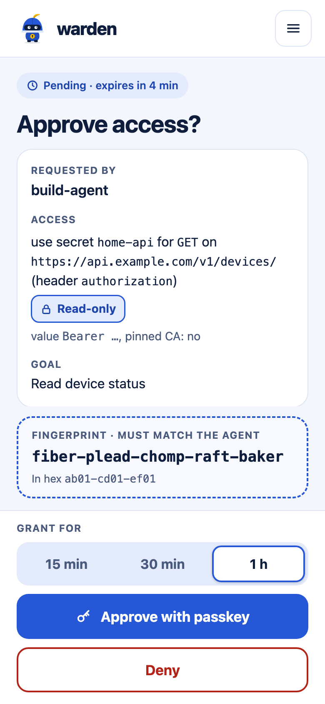

# warden

warden is a self-hosted **approval broker** for AI agents and scripts.

An agent asks for temporary access to a server or an API and says why. You
get a notification on your phone, read the goal and exactly what would be
granted, and approve with a passkey. warden then hands out access for a limited
window. When the window ends, API calls through warden are refused and relay
sessions are closed. On an SSH certificate target new logins stop, but a session
already open keeps running until it ends or is ended on the target. The agent's
machine holds no reusable SSH key, API token or target password, only the agent's
own identity key, which can ask for access and use active grants but cannot approve
anything.

The [project page](https://pecheriere.github.io/warden/) shows the flow, the
use cases and how to start.



## Try the demo

The fastest way to see warden work is a local demo. **It is a demo and is not
secure for real use**: everyone on the machine counts as the owner, and all its
data is throwaway. It shows the whole flow on one machine, with no Tailscale,
1Password, Docker or phone.

It currently needs [Rust](https://rustup.rs), because it is built from source:
whether to publish a demo binary has not been decided. You also need a browser
that can create a passkey. In a first terminal:

```sh
git clone https://github.com/pecheriere/warden && cd warden
cargo build --locked -p warden-demo -p warden-broker-cli
target/debug/warden-demo
```

It prints the exact next steps: enroll a passkey in your browser, request
access from a second terminal, approve, call a local API through the broker and
read the audit log. The demo is not in the image, and it covers API calls only.
[What it does and does not show](docs/demo.md).

For a real setup, go on to the [recommended setup](#recommended-setup) and the
[quick start](#quick-start).

## Who warden is for

warden is for people who leave AI agents or scripts working for them while
they get on with something else, and want them to reach their own servers,
devices and APIs without holding a standing credential for them. You run the server
yourself, so you need to be comfortable administering a Linux host and a
tailnet.

Each warden server has one owner, who approves every request. One owner can
have many agents, but there are no teams, roles or shared approvals.

**Status: early.** The current release is **0.8.1**. warden has a single
maintainer and has not had an independent security review. Before 1.0,
expect this to change:

- **Settings and upgrades.** Releases can include breaking changes, and
  database migrations are one-way. Read the [changelog](CHANGELOG.md) and
  back up before you upgrade.
- **How you install and set it up.** The CLI is built from source today
  ([#71](https://github.com/pecheriere/warden/issues/71)), and setup is
  manual ([#77](https://github.com/pecheriere/warden/issues/77),
  [#78](https://github.com/pecheriere/warden/issues/78)).
- **Which setups exist.** See [Supported setups](#supported-setups).

## Why warden

Password managers already keep secrets away from agents. With 1Password,
for example, an agent can use an SSH key through the SSH agent or run a
command with `op run`, and never see the secret itself. But each use is
approved on the computer, with the desktop app unlocked. That works while
you sit next to the agent. It does not work when you are away from that
computer, or when the agent runs on another machine. The request waits for
an unlock or a fingerprint you cannot give from where you are. Nothing is more
frustrating than coming back to your Mac to find the agent has sat on a
1Password prompt the whole time.

The usual way around this is a standing credential on the agent's machine,
such as an API token, an SSH key or a vault service account token. Those
work unattended, but they also work for anything at any time, and the
agent (or whatever compromises it) holds them for good. warden exists because
that is not an acceptable price for never getting stuck: no SSH key, API token or
target password on the agent's machine, and no access that is always on. The agent
keeps only its own identity key. That key can ask for access and use active grants,
but cannot approve anything, and it cannot be copied only if it is held in hardware.

Password managers are starting to close this gap. As of late 2026,
1Password lets some personal agents sign in to websites after you approve
each request. Its enterprise Privileged Access product grants
just-in-time access to infrastructure, with approvals in team tools like
Slack. Neither covers what warden is for: a coding agent in a terminal
getting SSH and API access to your own servers and devices, approved from
your phone, on a server you run.

warden takes a different approach: approval moves to your phone. The agent
asks for one piece of access, for one stated goal and a short window. You
approve or deny it from wherever you are. The secrets stay in your vault
and on the warden server (with the [weaker local backend](docs/local-backend.md),
on the server alone), and the agent only gets access for a limited window.

warden still needs a person. It frees you from the computer, not from
deciding. If nobody answers, the request expires after 10 minutes and the
agent has to ask again, and a grant lasts at most 4 hours. So an agent working
through the night has to stop and wait when its grant ends, or when it needs
something you have not approved, until you wake up. That is the trade: you stay in
the loop, and the agent holds no lasting credential for your servers or APIs.

## How it works

```
 agent machine                  warden (your server)              your phone
 ─────────────                  ────────────────────              ──────────
 warden request ssh web-01 ──▶  checks the policy in 1Password
   --goal "restart the …"       notifies you ───────────────────▶ notification
                                                                  approval page
                                approval ◀─────────────────────── passkey ✓
 ◀── grant (15 min) ─────────── issues the access

 warden ssh web-01 ───────────────────────────────────────────▶  web-01
   (short-lived certificate, or a session through warden's relay)
 warden http home-api GET … ──▶ adds the secret, calls the API,
                                redacts the answer
```

1. **Request.** The agent runs `warden request` with a target, a goal and a
   window (15 minutes to 4 hours). warden checks it against the policy, in a
   1Password vault in the recommended setup.
2. **Approve.** You get a notification (Home Assistant or ntfy). The link
   opens the approval page, reachable only from your phone over Tailscale,
   and you approve with a passkey, or deny. Missed it? The request waits on the
   Pending page until it expires.
3. **Use.** The agent gets exactly what you approved, for the window you
   chose, and warden writes what it does to a tamper-evident audit log.

What warden can grant:

| Access | How the agent gets it | What the agent never sees |
|--------|-----------------------|---------------------------|
| **SSH, certificate mode** | A certificate signed by warden's SSH CA, for a key that exists only in memory. It is valid for new logins during the window. A session already open keeps running after it, and warden cannot end it. | A reusable key for the target. |
| **SSH, relay mode** (appliances, password-only hosts) | A session through warden's SSH relay; warden logs in to the target. warden closes the session when the window ends or the grant is revoked. | The target's key or password. |
| **HTTP API calls** | warden makes each call, adds the secret, and returns the answer with the secret redacted. Calls are refused once the window ends or the grant is revoked. | The API secret. |

## Recommended setup

Run warden with **Tailscale, Docker and 1Password**, on a Linux server
dedicated to it. Tailscale is required today; Docker and 1Password have
[weaker alternatives](#supported-setups). What each part protects:

- **Tailscale** keeps warden off the internet and tells it who is calling.
  The tailnet policy keeps the approval page off agent machines, so a
  prompt-injected agent cannot put an approval prompt in front of you on a
  machine it controls.
- **Docker** runs warden and 1Password Connect as hardened containers: no
  capabilities, a read-only root filesystem and no published ports. Connect
  sits on its own network, so it cannot reach warden's listeners and forge
  your identity.
- **1Password** holds targets, API secrets and the SSH CA key in a dedicated
  vault, not in warden's database or configuration. warden's token is
  read-only and limited to that vault, so a compromised warden can read what
  the vault holds, but cannot change the policy or reach your other vaults.

### Supported setups

The first two use Docker and differ in how warden joins the tailnet. The first
three use 1Password Connect, which 1Password ships only as a container. The fourth
row changes where the secrets are, under any of them.

| Setup | State | Access | What it costs in security |
|-------|-------|--------|---------------------------|
| **Tailscale Services** on the host | Recommended. The [guide](docs/deployment.md#1-the-recommended-layout) is the main path. | SSH certificates, API calls. No SSH relay. | [The whole host is trusted](docs/deployment.md#who-can-reach-the-listeners). Any local process can reach the listeners and forge your login. That cannot approve anything, but it can read the history, revoke grants and use a stolen bearer key, so the host must run nothing else untrusted. |
| **Tailscale sidecar** container | [Documented](docs/deployment.md#10-the-sidecar-layout-for-relay-targets), but not yet tested end to end. | SSH certificates, API calls, SSH relay. | Other host processes cannot reach the listeners, but firewall rules can no longer tell warden's traffic from Tailscale's, and hardening the Tailscale container is untested. With relay targets, warden also [reads and uses their credentials](docs/threat-model.md#relay-mode-residual-risks), so a compromised warden can expose them. |
| **systemd service**, warden outside a container | [Documented](docs/deployment-systemd.md), but not yet tested on a clean host. Needs a release later than 0.8.1 and a build from source. | SSH certificates, API calls. No SSH relay. | As for Tailscale Services, the whole host is trusted. warden also [loses the image's isolation](docs/deployment-systemd.md#1-what-holds-what-is-replaced-what-is-lost): it shares the host's filesystem (read-only) and network stack, and there is no build attestation yet. |

| **Local files** instead of 1Password | [Documented](docs/local-backend.md). The backend is tested; its Docker and systemd examples have not been run on a real host. Needs a release later than 0.8.1. | As the layout it runs on. | **A compromised host gets every secret**: the vault's separation from the host is gone, and with it the [read-only token boundary](docs/threat-model.md#the-local-secret-backend). Backups and disks hold the secrets too. 1Password stays the recommendation. |

The [local demo](docs/demo.md) is for trying warden, not one of these setups:
it is not secure for real use.

Approving without Tailscale is planned but **does not exist yet**
([#75](https://github.com/pecheriere/warden/issues/75)).

### Requirements

- A Linux server dedicated to warden, on a
  [Tailscale](https://tailscale.com) tailnet. warden is reachable only over
  the tailnet.
- **Docker Engine 28 or later and Docker Compose 2.33 or later.** Older
  engines let other LAN machines reach unpublished container ports, which
  would expose warden's listeners
  ([why](docs/deployment.md#deploying-warden)).
- A 1Password account that can run a
  [1Password Connect](https://developer.1password.com/docs/connect/) server
  (recommended; [local files](docs/local-backend.md) are the weaker alternative).
- A phone with a passkey (and on the tailnet).
- A notification channel: [Home Assistant or ntfy](docs/notifications.md).
- On each agent machine: the `warden` CLI and OpenSSH.

## Quick start

This is the short path through the recommended setup, and it needs everything
above. To look first without any of that, [try the demo](#try-the-demo).
[Deployment](docs/deployment.md) explains each step and the reasons behind
it; follow it for a real setup.

1. **Tailscale.** Tag the server `tag:warden-host`, and publish warden as
   two [Tailscale Services][svc]: `svc:warden` (the approval UI) granted to
   your phone only, and `svc:warden-api` (the agent API) granted to the
   agent machines only. Add policy tests so the agent machines can never
   reach the approval UI.
   [The policy and commands](docs/deployment.md#2-tailscale).
   SSH **relay** targets (appliances that cannot trust a CA) need the
   [sidecar layout](docs/deployment.md#10-the-sidecar-layout-for-relay-targets)
   instead; that recipe has not yet been tested end to end.

2. **1Password.** Create a dedicated `Warden` vault, a Connect server for
   that vault only, a read-only token, and the SSH CA key. Run this in a
   private directory: `op connect server create` writes the credentials
   file `1password-credentials.json` there, and the token is printed once
   ([how to move both safely](docs/deployment.md#3-1password)):

   ```sh
   op vault create Warden
   op connect server create warden-connect --vaults Warden
   op connect token create warden-read --server warden-connect --vault Warden,r
   op item create --vault Warden --category "SSH Key" \
     --title warden-ssh-ca --tags warden:ssh-ca --ssh-generate-key ed25519
   ```

3. **Run Connect and warden** with Docker Compose: hardened containers, no
   published ports, Connect on its own network. Verify the image first:

   ```sh
   gh attestation verify oci://ghcr.io/pecheriere/warden:0.8.1 --owner pecheriere
   ```

   [The Compose file](docs/deployment.md#5-run-warden),
   [every setting](docs/configuration.md), and
   [the notification channel](docs/notifications.md), which warden needs in
   order to start.

4. **Publish the Services** on the server:

   ```sh
   tailscale serve --service=svc:warden     --https=443 --bg http://172.31.250.10:8081
   tailscale serve --service=svc:warden-api --https=443 --bg http://172.31.250.10:8080
   ```

5. **Enroll your passkey.** Run this, then open the printed URL on your
   phone and enter the code:

   ```sh
   docker compose exec warden /warden-server enroll
   ```

6. **Add a target.** Create its item in the vault and let the host trust
   the CA for that target only. [SSH targets](docs/ssh-targets.md),
   [API secrets](docs/1password-items.md#api-secret).

7. **Enroll an agent** and log in from its machine. With a signing key:

   ```sh
   # on the server, with the agent's public key line
   docker compose exec warden /warden-server agent add build-agent \
     --public-key "ssh-ed25519 AAAA… build-agent"
   # on the agent machine (Rust 1.99 or later; releases after v0.8.1 also
   # attach binaries, see Agent usage)
   cargo install --locked --git https://github.com/pecheriere/warden --tag v0.8.1 warden-broker-cli
   warden login --server https://warden-api.example.ts.net --agent build-agent \
     --ssh-key ~/.ssh/build-agent.pub
   ```

   Which key to use (and when a bearer key is the right choice) is in
   [Agent usage](docs/agent-usage.md#one-time-setup).

8. **Request and use access:**

   ```sh
   warden request ssh web-01 --user build-agent --for 15m \
     --goal "restart the web container after the config change in PR #42"
   warden ssh web-01 -- docker restart web
   warden revoke <grant-id>
   ```

[svc]: https://tailscale.com/kb/1552/tailscale-services

## Documentation

| Document | For |
|----------|-----|
| [Local demo](docs/demo.md) | Trying the flow on one machine, and what that leaves out. |
| [Deployment](docs/deployment.md) | Running warden safely: Tailscale, 1Password Connect, networks, notifications, backups, upgrades. |
| [Configuration](docs/configuration.md) | Every environment variable and command of the server and the CLI. |
| [SSH targets](docs/ssh-targets.md) | Setting up hosts: one user per agent, certificate-only logins, relay targets. |
| [1Password items](docs/1password-items.md) | The exact tags and fields of targets, API secrets and the CA. |
| [Local files](docs/local-backend.md) | The weaker backend without 1Password: its policy file, secret files and what it gives up. |
| [Notifications](docs/notifications.md) | Home Assistant and ntfy. |
| [Agent usage](docs/agent-usage.md) | Setting up an agent and how it should ask for access. |
| [Agent instructions](docs/agent-instructions.md) | A block to paste into an agent's `AGENTS.md` or `CLAUDE.md`. |
| [Examples](docs/agent-examples.md) | An SSH deployment and an API call, end to end. |
| [Agent protocol](docs/agent-protocol.md) | The agent API, for writing another client. |
| [Verifying a release](docs/verifying-releases.md) | Checking signatures and attestations on the CLI, the image and the tags. |
| [Reproducing a build](docs/reproducing-builds.md) | Rebuilding a release and comparing it with what was published. |
| [External interfaces](docs/interfaces.md) | Everything warden accepts and calls, with the approval UI's routes and the SSH relay. |
| [Threat model](docs/threat-model.md) | What warden protects, what it does not, and what it assumes. |
| [Assurance case](docs/assurance-case.md) | Trust boundaries, design principles, weaknesses and cryptography, with pointers to the code, and how to replace each credential. |
| [Security assessment](docs/security-assessment.md) | A dated ranking of what is most likely to go wrong. The project's own, not an independent review. |
| [Design](docs/design.md) | The design and its decisions. |
| [Design language](docs/design-language.md) | The approval UI's visual design. |
| [Upgrading](docs/upgrading.md) | The upgrade path, and which releases get fixes. |
| [Building and dependencies](docs/building.md) | Building from source, and how dependencies are chosen and tracked. |
| [Roadmap](docs/roadmap.md) | What warden intends to work on next. |
| [Contributing](CONTRIBUTING.md) | Where to discuss, reporting bugs, making a change, the test policy. |
| [Governance](GOVERNANCE.md) | Who decides, roles, and who has access to what. |
| [Code of conduct](CODE_OF_CONDUCT.md) | Contributor Covenant 3.0, and where reports go. |

## Security

- **An agent can only ask.** Every grant needs a passkey approval from your
  enrolled device, on an approval page that only your phone can reach.
- **Bounded grants.** At most four hours, one target or secret, the account
  or methods you approved. API requests are read-only unless the agent asks
  for more, and the page says so. On a certificate target the limit is on new
  logins: [one already open continues](docs/threat-model.md#accepted-residual-risks).
- **No standing credentials for your systems on the agent machine.** SSH keys
  are made per request and live only in memory; API and relay credentials never
  leave warden. The agent keeps only its own identity key, a signing key or a
  bearer key. It can ask for access and use active grants until you revoke the
  agent, but cannot approve anything. A key in hardware cannot be copied; a key
  file or a bearer key [can be](docs/security-assessment.md#ranked-risks).
- **Nothing on the internet.** warden is reachable only over your tailnet,
  never through Funnel.
- **Audited.** Every request, decision, relay session and API call goes to a
  hash-chained audit log. Certificate logins go straight to the target, so
  only its `sshd` logs them. Secrets never reach the log or the notifications.

warden does not protect against whoever controls the warden host (it is the
root of trust; with the local backend it holds every secret too) or the
1Password vault, against an approved agent or code on
its machine misusing its window, or against a misleading goal you approve.
Grants are not yet tied to a task, so one
agent's sessions can share them
([#49](https://github.com/pecheriere/warden/issues/49)), a revoke stops an API
call in flight but cannot undo what the API did with it, and it does not cancel
an issued certificate ([#35](https://github.com/pecheriere/warden/issues/35)). The
[threat model](docs/threat-model.md) has the full picture.

Report a vulnerability privately as described in [SECURITY.md](SECURITY.md).

## Components

| Component | Crate | What it is |
|-----------|-------|------------|
| `warden-server` | `warden-broker` | The broker: agent API, approval UI, SSH CA, SSH relay, HTTP proxy, notifications, audit log, SQLite state. Runs as a container. |
| `warden` | `warden-broker-cli` | The agent's CLI: requests access, waits for the decision, keeps the per-grant key in an `ssh-agent`, wraps `ssh` and makes API calls (`warden http`). |
| | `warden-broker-proto` | The wire types and the request-signing protocol shared by both. |

## Development

Start with [CONTRIBUTING.md](CONTRIBUTING.md). The tools to install are in
[Building and dependencies](docs/building.md).

The checks CI runs:

```sh
cargo fmt --check
scripts/check-no-reqwest-decompression.sh
cargo clippy --workspace --all-targets --all-features --locked -- -D warnings
cargo test --workspace --all-features --locked
RUSTDOCFLAGS="-D warnings" cargo doc --workspace --all-features --no-deps --locked
cargo deny check
```

The relay tests start an unprivileged OpenSSH server, so they need
`/usr/sbin/sshd`. On Linux the password-target tests also need the current
user's password in `WARDEN_TEST_LOGIN_PASSWORD` (CI sets a random one).

Pull requests also run [zizmor](https://docs.zizmor.sh) on the workflows
(`uvx zizmor@1.31.1 .` locally) and CodeQL. `cargo deny check advisories` runs
every night on `main`, so a newly published advisory shows up there before it
fails an unrelated pull request, and OpenSSF Scorecard reports weekly.

### Dependency age

Every crate version in `Cargo.lock` and `fuzz/Cargo.lock` must have been
published on crates.io at least 7 days before it is added, so a compromised or
broken release has time to be noticed and yanked. On each pull request,
[`.github/scripts/crate_age.py`](.github/scripts/crate_age.py) compares
the lockfiles with the base branch's and fails the build for a new or changed
version younger than 7 days; a lookup that fails fails the check. The release
workflow runs the same check against the previous release tag, so a tag never
ships a version that skipped it. Dependabot waits out the same 7 days.

The one exception is the oldest release that fixes a security advisory. List
it in [`.github/crate-age-allow.toml`](.github/crate-age-allow.toml), one entry
per crate version, with a reason that names the advisory (RUSTSEC or GHSA):

```toml
[[allow]]
name = "some-crate"
version = "1.2.3"
reason = "Oldest release without RUSTSEC-2026-0001"
```

An entry whose version leaves `Cargo.lock` is stale and fails the check, so it
is removed with the update that replaces the crate. To run the check locally:

```sh
python3 -I .github/scripts/crate_age.py --base main
```

Pull requests follow [the template](.github/pull_request_template.md);
approval UI changes follow the [design language](docs/design-language.md).

## License

Licensed under either of [MIT](LICENSE-MIT) or [Apache-2.0](LICENSE-APACHE),
at your option.
