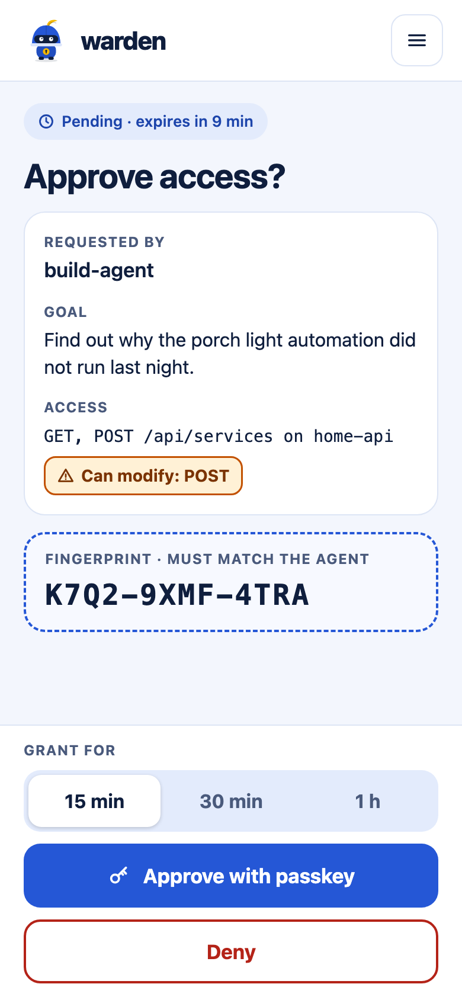

# warden

warden is a self-hosted **approval broker** for AI agents and scripts.

An agent asks for temporary access to a server or an API and says why. You
get a notification on your phone, read the goal and exactly what would be
granted, and approve with a passkey. warden then hands out access that
expires on its own. The agent never holds a long-lived secret.



## Why warden

Password managers already keep secrets away from agents. With 1Password,
for example, an agent can use an SSH key through the SSH agent or run a
command with `op run`, and never see the secret itself. But each use is
approved on the computer, with the desktop app unlocked. That works while
you sit next to the agent. It does not work unattended: overnight, while
you are away, or when the agent runs on another machine. The request waits
for an unlock or a fingerprint that nobody can give.

The usual way around this is a standing credential on the agent's machine,
such as an API token, an SSH key or a vault service account token. Those
work unattended, but they also work for anything at any time, and the
agent (or whatever compromises it) holds them for good.

Password managers are starting to close this gap. As of late 2026,
1Password lets some personal agents sign in to websites after you approve
each request. Its enterprise Privileged Access product grants
just-in-time access to infrastructure, with approvals in team tools like
Slack. Neither covers what warden is for: a coding agent in a terminal
getting SSH and API access to your own servers and devices, approved from
your phone, on a server you run.

warden takes a different approach: approval moves to your phone. The agent
asks for one piece of access, for one stated goal and a short window. You
approve or deny it from wherever you are. The secrets stay in your vault
and on the warden server, and the agent only gets access that expires.

## How it works

```
 agent machine                  warden (your server)              your phone
 ─────────────                  ────────────────────              ──────────
 warden request ssh web-01 ──▶  checks the policy in 1Password
   --goal "restart the …"       notifies you ───────────────────▶ notification
                                                                  approval page
                                approval ◀─────────────────────── passkey ✓
 ◀── grant (15 min) ─────────── issues the access

 warden ssh web-01 ───────────────────────────────────────────▶  web-01
   (short-lived certificate, or a session through warden's relay)
 warden http home-api GET … ──▶ adds the secret, calls the API,
                                redacts the answer
```

1. **Request.** The agent runs `warden request` with a target, a goal and a
   window (15 minutes to 4 hours). warden checks it against the policy in a
   1Password vault.
2. **Approve.** You get a notification (Home Assistant or ntfy). The link
   opens the approval page, reachable only from your phone over Tailscale,
   and you approve with a passkey, or deny.
3. **Use.** The agent gets exactly what you approved, for the window you
   chose, and every step is written to a tamper-evident audit log.

What warden can grant:

| Access | How the agent gets it | What the agent never sees |
|--------|-----------------------|---------------------------|
| **SSH, certificate mode** | A certificate signed by warden's SSH CA, valid for the window, for a key that exists only in memory. | Any reusable key. |
| **SSH, relay mode** (appliances, password-only hosts) | A session through warden's SSH relay; warden logs in to the target. | The target's key or password. |
| **HTTP API calls** | warden makes each call, adds the secret, and returns the answer with the secret redacted. | The API secret. |

Status: early development, for one owner. The current release is
**0.7.0**; see the [changelog](CHANGELOG.md).

## Requirements

- A Linux server dedicated to warden, on a
  [Tailscale](https://tailscale.com) tailnet. warden is reachable only over
  the tailnet.
- **Docker Engine 28 or later and Docker Compose 2.33 or later.** Older
  engines let other LAN machines reach unpublished container ports, which
  would expose warden's listeners
  ([why](docs/deployment.md#deploying-warden)).
- A 1Password account that can run a
  [1Password Connect](https://developer.1password.com/docs/connect/) server.
- A phone with a passkey (and on the tailnet).
- On each agent machine: the `warden` CLI and OpenSSH.

## Quick start

This is the short path. [Deployment](docs/deployment.md) explains each step
and the reasons behind it; follow it for a real setup.

1. **Tailscale.** Tag the server `tag:warden-host`, and publish warden as
   two [Tailscale Services][svc]: `svc:warden` (the approval UI) granted to
   your phone only, and `svc:warden-api` (the agent API) granted to the
   agent machines only. Add policy tests so the agent machines can never
   reach the approval UI.
   [The policy and commands](docs/deployment.md#2-tailscale).
   SSH **relay** targets (appliances that cannot trust a CA) need the
   [sidecar layout](docs/deployment.md#10-the-sidecar-layout-for-relay-targets)
   instead; that recipe has not yet been tested end to end.

2. **1Password.** Create a dedicated `Warden` vault, a Connect server for
   that vault only, a read-only token, and the SSH CA key. Run this in a
   private directory: `op connect server create` writes the credentials
   file `1password-credentials.json` there, and the token is printed once
   ([how to move both safely](docs/deployment.md#3-1password)):

   ```sh
   op vault create Warden
   op connect server create warden-connect --vaults Warden
   op connect token create warden-read --server warden-connect --vault Warden,r
   op item create --vault Warden --category "SSH Key" \
     --title warden-ssh-ca --tags warden:ssh-ca --ssh-generate-key ed25519
   ```

3. **Run Connect and warden** with Docker Compose: hardened containers, no
   published ports, Connect on its own network. Verify the image first:

   ```sh
   gh attestation verify oci://ghcr.io/pecheriere/warden:0.7.0 --owner pecheriere
   ```

   [The Compose file](docs/deployment.md#5-run-warden), and
   [every setting](docs/configuration.md).

4. **Publish the Services** on the server:

   ```sh
   tailscale serve --service=svc:warden     --https=443 --bg http://172.31.250.10:8081
   tailscale serve --service=svc:warden-api --https=443 --bg http://172.31.250.10:8080
   ```

5. **Enroll your passkey.** Run this, then open the printed URL on your
   phone and enter the code:

   ```sh
   docker compose exec warden /warden-server enroll
   ```

6. **Add a target.** Create its item in the vault and let the host trust
   the CA for that target only. [SSH targets](docs/ssh-targets.md),
   [API secrets](docs/1password-items.md#api-secret).

7. **Enroll an agent** and log in from its machine. With a signing key:

   ```sh
   # on the server, with the agent's public key line
   docker compose exec warden /warden-server agent add build-agent \
     --public-key "ssh-ed25519 AAAA… build-agent"
   # on the agent machine
   cargo install --locked --git https://github.com/pecheriere/warden --tag v0.7.0 warden-broker-cli
   warden login --server https://warden-api.example.ts.net --agent build-agent \
     --ssh-key ~/.ssh/build-agent.pub
   ```

   Which key to use (and when a bearer key is the right choice) is in
   [Agent usage](docs/agent-usage.md#one-time-setup).

8. **Request and use access:**

   ```sh
   warden request ssh web-01 --user build-agent --for 15m \
     --goal "restart the web container after the config change in PR #42"
   warden ssh web-01 -- docker restart web
   warden revoke <grant-id>
   ```

[svc]: https://tailscale.com/kb/1552/tailscale-services

## Documentation

| Document | For |
|----------|-----|
| [Deployment](docs/deployment.md) | Running warden safely: Tailscale, 1Password Connect, networks, notifications, backups, upgrades. |
| [Configuration](docs/configuration.md) | Every environment variable and command of the server and the CLI. |
| [SSH targets](docs/ssh-targets.md) | Setting up hosts: one user per agent, certificate-only logins, relay targets. |
| [1Password items](docs/1password-items.md) | The exact tags and fields of targets, API secrets and the CA. |
| [Notifications](docs/notifications.md) | Home Assistant and ntfy. |
| [Agent usage](docs/agent-usage.md) | Setting up an agent and how it should ask for access. |
| [Agent protocol](docs/agent-protocol.md) | The agent API, for writing another client. |
| [Threat model](docs/threat-model.md) | What warden protects, what it does not, and what it assumes. |
| [Design](docs/design.md) | The design and its decisions. |
| [Design language](docs/design-language.md) | The approval UI's visual design. |

## Security

- **An agent can only ask.** Every grant needs a passkey approval from your
  enrolled device, on an approval page that only your phone can reach.
- **Bounded grants.** At most four hours, one target or secret, the account
  or methods you approved. API requests are read-only unless the agent asks
  for more, and the page says so.
- **No standing secrets on the agent machine.** SSH keys are made per
  request and live only in memory; API and relay credentials never leave
  warden; a key-signed agent stores nothing secret.
- **Nothing on the internet.** warden is reachable only over your tailnet,
  never through Funnel.
- **Audited.** Every request, decision and use goes to a hash-chained audit
  log. Secrets never reach the log or the notifications.

warden does not protect against whoever controls the warden host (it is the
root of trust), against an approved agent misusing its window, or against a
misleading goal you approve. Grants are not yet tied to a task, so one
agent's sessions can share them
([#49](https://github.com/pecheriere/warden/issues/49)), and a revoke does
not cancel an API call already in flight
([#44](https://github.com/pecheriere/warden/issues/44)) or an issued
certificate ([#35](https://github.com/pecheriere/warden/issues/35)). The
[threat model](docs/threat-model.md) has the full picture.

Report a vulnerability privately as described in [SECURITY.md](SECURITY.md).

## Components

| Component | Crate | What it is |
|-----------|-------|------------|
| `warden-server` | `warden-broker` | The broker: agent API, approval UI, SSH CA, SSH relay, HTTP proxy, notifications, audit log, SQLite state. Runs as a container. |
| `warden` | `warden-broker-cli` | The agent's CLI: requests access, waits for the decision, keeps the per-grant key in an `ssh-agent`, wraps `ssh` and makes API calls (`warden http`). |
| | `warden-broker-proto` | The wire types and the request-signing protocol shared by both. |

## Development

The checks CI runs:

```sh
cargo fmt --check
scripts/check-no-reqwest-decompression.sh
cargo clippy --workspace --all-targets --all-features --locked -- -D warnings
cargo test --workspace --all-features --locked
RUSTDOCFLAGS="-D warnings" cargo doc --workspace --all-features --no-deps --locked
cargo deny check
```

The relay tests start an unprivileged OpenSSH server, so they need
`/usr/sbin/sshd`. On Linux the password-target tests also need the current
user's password in `WARDEN_TEST_LOGIN_PASSWORD` (CI sets a random one).

Pull requests also run [zizmor](https://docs.zizmor.sh) on the workflows
(`uvx zizmor@1.31.1 .` locally) and CodeQL. `cargo deny check advisories` runs
every night on `main`, so a newly published advisory shows up there before it
fails an unrelated pull request, and OpenSSF Scorecard reports weekly.

### Dependency age

Every crate version in `Cargo.lock` must have been published on crates.io at
least 14 days before it is added, so a compromised or broken release has time
to be noticed and yanked. On each pull request,
[`.github/scripts/crate_age.py`](.github/scripts/crate_age.py) compares
`Cargo.lock` with the base branch's and fails the build for a new or changed
version younger than 14 days; a lookup that fails fails the check. The release
workflow runs the same check against the previous release tag, so a tag never
ships a version that skipped it. Dependabot waits out the same 14 days.

The one exception is the oldest release that fixes a security advisory. List
it in [`.github/crate-age-allow.toml`](.github/crate-age-allow.toml), one entry
per crate version, with a reason that names the RUSTSEC advisory:

```toml
[[allow]]
name = "some-crate"
version = "1.2.3"
reason = "Oldest release without RUSTSEC-2026-0001"
```

An entry whose version leaves `Cargo.lock` is stale and fails the check, so it
is removed with the update that replaces the crate. To run the check locally:

```sh
python3 -I .github/scripts/crate_age.py --base main
```

Pull requests follow [the template](.github/pull_request_template.md);
approval UI changes follow the [design language](docs/design-language.md).

## License

Licensed under either of [MIT](LICENSE-MIT) or [Apache-2.0](LICENSE-APACHE),
at your option.
