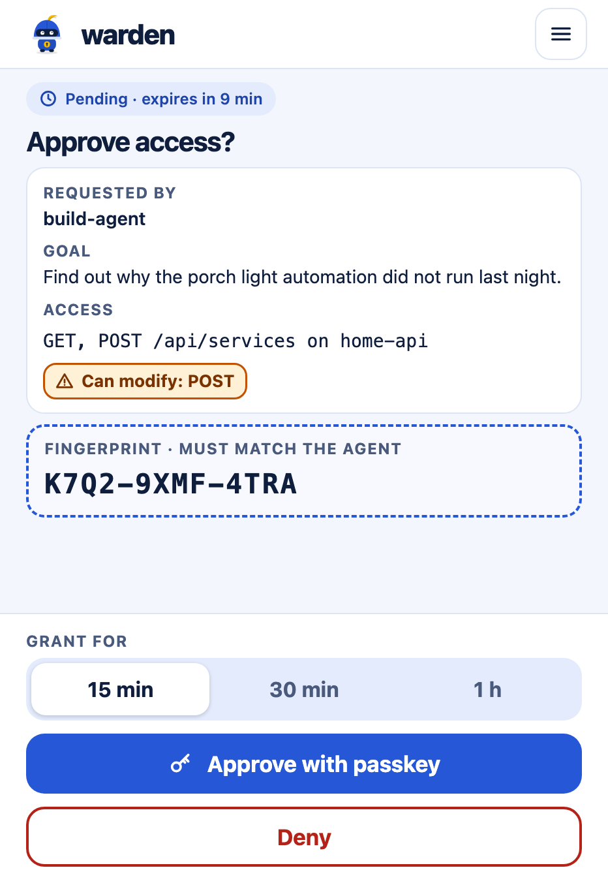
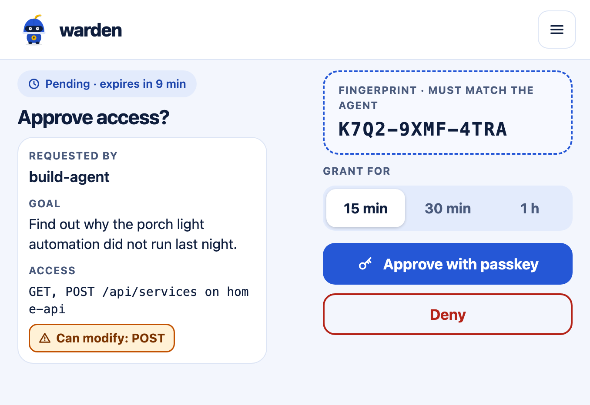
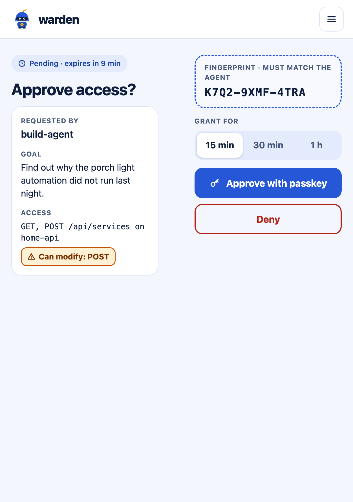
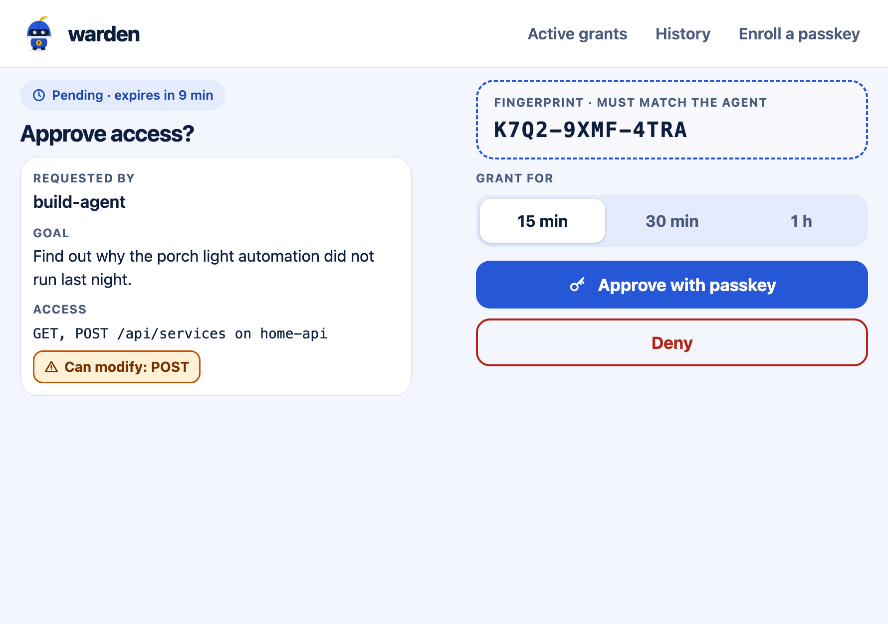

# Design language: Sky Guard

Every page of the approval UI uses this design language: the same tokens,
components and mascot, and no page-specific colours or one-off components.
A pull request that adds or changes a page includes screenshots of it (see
[Screenshots](#screenshots)).

The reference pages in [`design/reference/`](design/reference/) are
standalone HTML files that implement everything below. They are the visual
target for the approval UI (#33), not code the broker serves.

## Principles

- **The decision comes first.** The fingerprint, the access line, the
  read-only or can-modify badge and the Approve / Deny buttons are the most
  prominent things on the approve page. Approve and Deny have the same size;
  neither looks pre-chosen.
- **Colourful but calm.** One colour family (cobalt) with one accent
  (sunflower) used sparingly: the mascot's plume and keyhole, live indicators.
  The accent never carries text.
- **Phone first, any shape.** The owner approves on a phone, including a
  foldable used folded or unfolded, in either orientation. Desktop works too.
- **Nothing external.** The broker's content security policy allows no
  external fonts, stylesheets, scripts or images: system fonts, CSS from the
  broker, the mascot as inline SVG.

## Tokens

| Token | Light | Dark | Use |
|---|---|---|---|
| `--ground` | `#F3F6FD` | `#0B1530` | Page background |
| `--surface` | `#FFFFFF` | `#142348` | Cards, header, decision panel |
| `--ink` | `#0F1E3D` | `#EAF0FF` | Body text |
| `--muted` | `#4A5A7C` | `#A5B4D8` | Labels, secondary text |
| `--line` | `#DDE5F5` | `#22346A` | Borders, dividers |
| `--primary` | `#2557D6` | `#8FB0FF` | Approve button, fingerprint frame, links |
| `--on-primary` | `#FFFFFF` | `#0B1530` | Text on `--primary` |
| `--soft` | `#E3EBFC` | `#1B2D5C` | Chips, segmented control track, read-only badge |
| `--soft-ink` | `#1D45AB` | `#C9D7FF` | Text on `--soft` |
| `--accent` | `#F5B800` | `#F5B800` | Mascot plume and keyhole, live dot; never text |
| `--warn-bg` / `--warn-ink` / `--warn-line` | `#FFF1D6` / `#7A3300` / `#C25100` | `#3A2306` / `#FFD08A` / `#E08A2C` | "Can modify" badge |
| `--deny` | `#B42318` | `#FF8A80` | Deny and Revoke buttons |
| `--fp-bg` | `#F7F9FF` | `#101D40` | Fingerprint box |

Dark mode follows `prefers-color-scheme`. (The reference pages switch with a
`dark` class on `<html>` so both modes can be captured.) All text pairs meet
WCAG AA contrast in both modes.

## Type and shape

- **Fonts**: `system-ui, -apple-system, "Segoe UI", Roboto, sans-serif`; and
  `ui-monospace, SFMono-Regular, Menlo, monospace` for fingerprints, access
  lines and ids.
- **Headings**: bold, `letter-spacing: -0.025em`; page title 29 px (21–23 px on
  short screens).
- **Labels**: 12 px, bold, uppercase, `letter-spacing: 0.06em`, `--muted`.
- **Radii**: cards 18 px, buttons 14 px, chips and pills fully rounded.
- **Borders**: 1 px `--line`; almost no shadows (only the selected segment).
- **Touch targets**: at least 44 px high.

## Components

- **Header**: mascot (38 px) and the `warden` wordmark; navigation (Active
  grants, History, Enroll a passkey) inline from 720 px, behind a menu button
  below.
- **Status chip**: pill on `--soft`, an icon and short text ("Pending ·
  expires in 9 min", "Approved").
- **Card**: `--surface`, label / value fields.
- **Badges**: read-only (lock icon, `--soft` with a `--primary` border) and
  can modify (warning icon, `--warn-*`), always with text, never colour alone.
- **Fingerprint box**: dashed 2 px `--primary` frame, monospace, bold, never
  wraps (it scales down instead).
- **Segmented control** for the grant window: real radio inputs in a
  `<fieldset>` with a legend.
- **Buttons**: Approve filled `--primary`; Deny and Revoke with a 2 px
  `--deny` outline and `--deny` text; secondary actions with a 2 px `--line`
  outline.
- **Live indicator**: `--accent` dot plus text ("1 session open").

## Mascot

A small knight in a round helmet: brave, not scary. [`design/mascot.svg`](design/mascot.svg)
is the master. Helmet and body in `--primary` cobalt, visor in ink, plume and
keyhole badge in `--accent`. It appears at 38 px in the header and at about
160 px on finished and empty states (approved, denied, nothing to approve). It
is inlined in the page (no image request), carries `aria-hidden="true"` where
it is decoration, and never animates in a way that delays the decision
(respect `prefers-reduced-motion`).

## Layout

| Screen | Approve page layout |
|---|---|
| Under 600 px wide (phones, a folded foldable in portrait) | One column. The decision panel (grant window, Approve, Deny) is pinned to the bottom, so it is always reachable; the details scroll above it. |
| 600 px wide and up (an unfolded foldable, tablets, desktop, a folded foldable in landscape) | Two columns: details on the left; fingerprint and decision panel on the right. The 64 px gap between them falls on the hinge of an unfolded foldable. |
| 1000 px wide and up | Approve and Deny side by side. |
| Up to 700 px tall | Compact spacing and type, so the fingerprint and the decision fit without scrolling. |

The page uses `viewport-fit=cover` and pads with `env(safe-area-inset-*)`.
Agent-controlled text (goals, agent names) wraps and stays in `<bdi>`; it
never pushes the fingerprint or the buttons off screen. Lists such as
Active grants are cards on a phone, not wide tables.

### Foldables

Foldable phones such as the iPhone Duo are first-class targets. Its CSS
viewport is not published; the sizes below assume a 3× scale from its panel resolutions
(outer 1398 × 2034, inner 2670 × 1878) and must be checked on the device:

| State | Viewport (CSS px) |
|---|---|
| Folded, portrait | 466 × 678 |
| Folded, landscape | 678 × 466 |
| Unfolded, portrait | 626 × 890 |
| Unfolded, landscape | 890 × 626 |

| Folded, portrait | Folded, landscape |
|---|---|
|  |  |

| Unfolded, portrait | Unfolded, landscape |
|---|---|
|  |  |

## Screenshots

A pull request that adds or changes a page of the approval UI includes
screenshots of every page it touches at these sizes, in light and dark:

- Phone: 390 × 844
- Foldable: 466 × 678, 678 × 466, 626 × 890, 890 × 626
- Desktop: 1280 × 800

Other examples: [approve, dark](design/mockups/approve-iphone-dark.png),
[approve, desktop dark](design/mockups/approve-desktop-dark.png),
[approved](design/mockups/approved-iphone-light.png),
[approved, folded landscape dark](design/mockups/approved-duo-closed-landscape-dark.png),
[active grants](design/mockups/grants-iphone-light.png),
[active grants, desktop dark](design/mockups/grants-desktop-dark.png).
